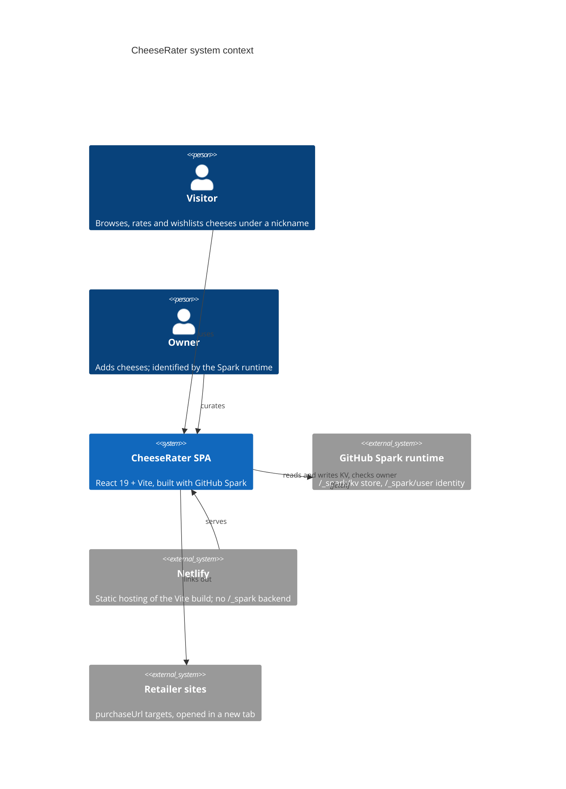
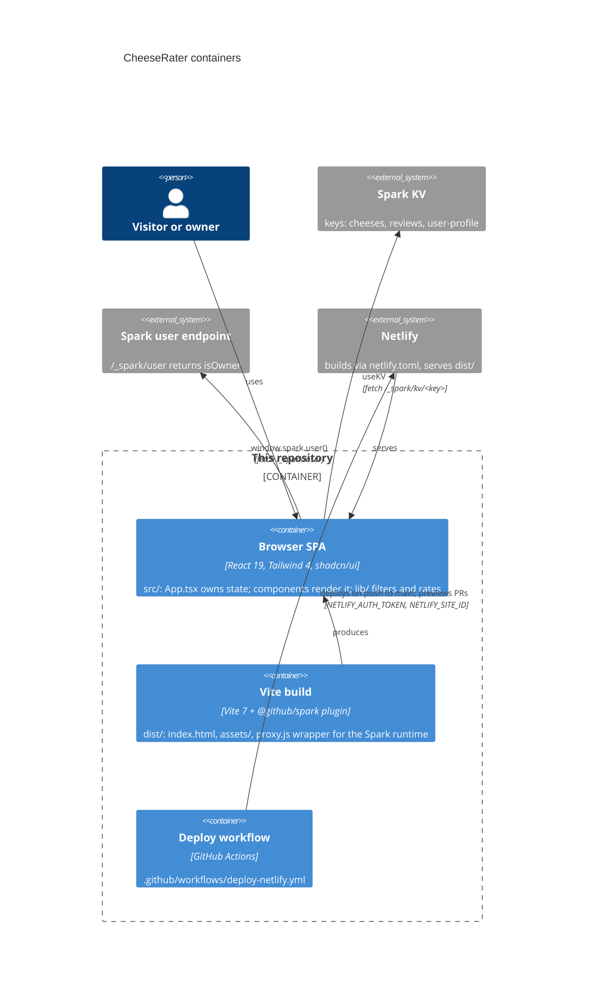

# Architecture

Derived from `src/main.tsx`, `src/App.tsx`, `vite.config.ts`, `netlify.toml` and `.github/workflows/deploy-netlify.yml`.

## Context

## Containers

## Notes

- `src/vite-end.d.ts` declares `BASE_KV_SERVICE_URL` and `GITHUB_RUNTIME_PERMANENT_NAME`; the Spark Vite plugin defines them at build time (`/_spark/kv` and the app id in `runtime.config.json`).
- KV keys are app-wide, not per user. `user-profile` therefore holds one nickname, wishlist and tried list for everyone.
- The per-device id in localStorage (`src/lib/cheese-utils.ts`) is the only user scoping; it matches a review to its author for editing.
